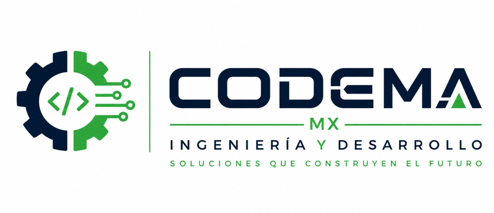

  <picture>
    <source media="(prefers-color-scheme: dark)" srcset="assets/banner-dark.jpg">
    
  </picture>

## Codema MX

Empresa mexicana de ingeniería y desarrollo. Diseñamos y construimos soluciones completas: desde el control y la electrónica hasta el software que las opera.

### Qué hacemos

| Área | Alcance |
| --- | --- |
| **Software a la medida** | Plataformas web, aplicaciones móviles y APIs |
| **Automatización industrial** | Programación de PLC, interfaces HMI/SCADA y digitalización de procesos |
| **Electrónica y sistemas embebidos** | Diseño de hardware, firmware y comunicación entre dispositivos |
| **Integración** | Sistemas electromecánicos completos: estructura, tablero, control y software |

### Tecnología

TypeScript · NestJS · Next.js · Flutter · PostgreSQL · Python · C/C++ para microcontroladores

### Cómo trabajamos

- Cada proyecto se documenta: arquitectura, decisiones y estado real.
- Integración continua y revisión de código en cada cambio.
- Entregas verificadas en el equipo real, no solo en el simulador.

---

© Codema MX · Ingeniería y Desarrollo · México

